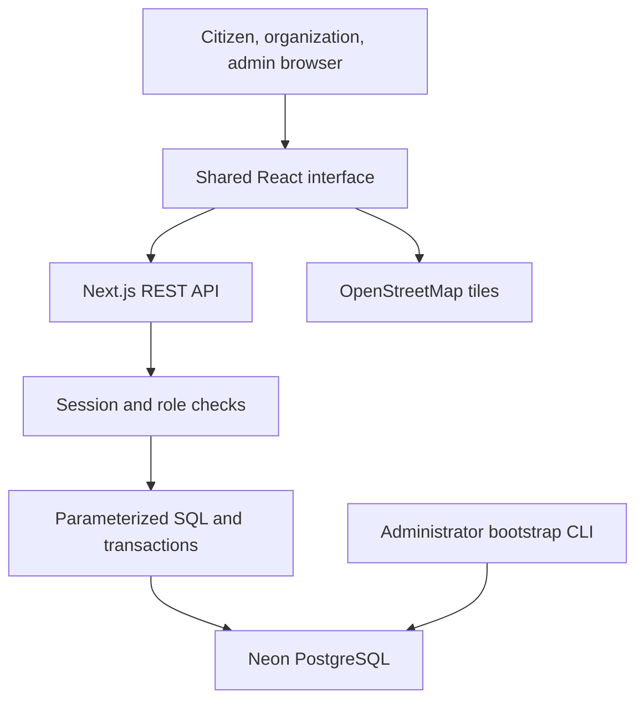
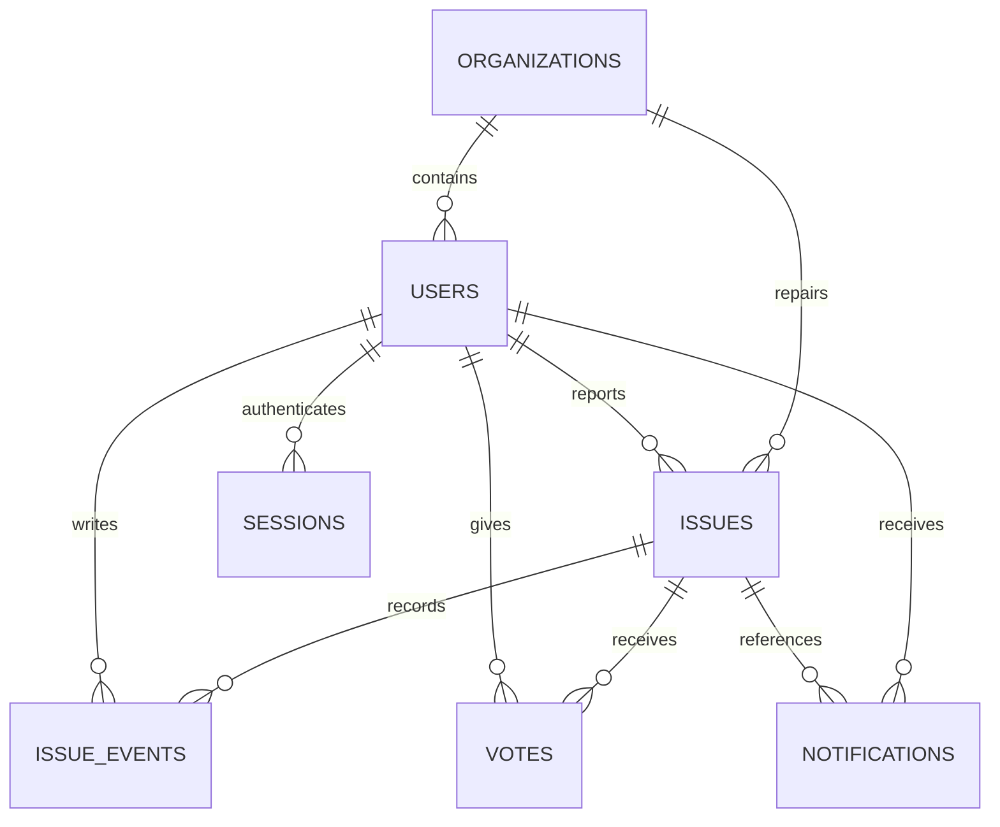
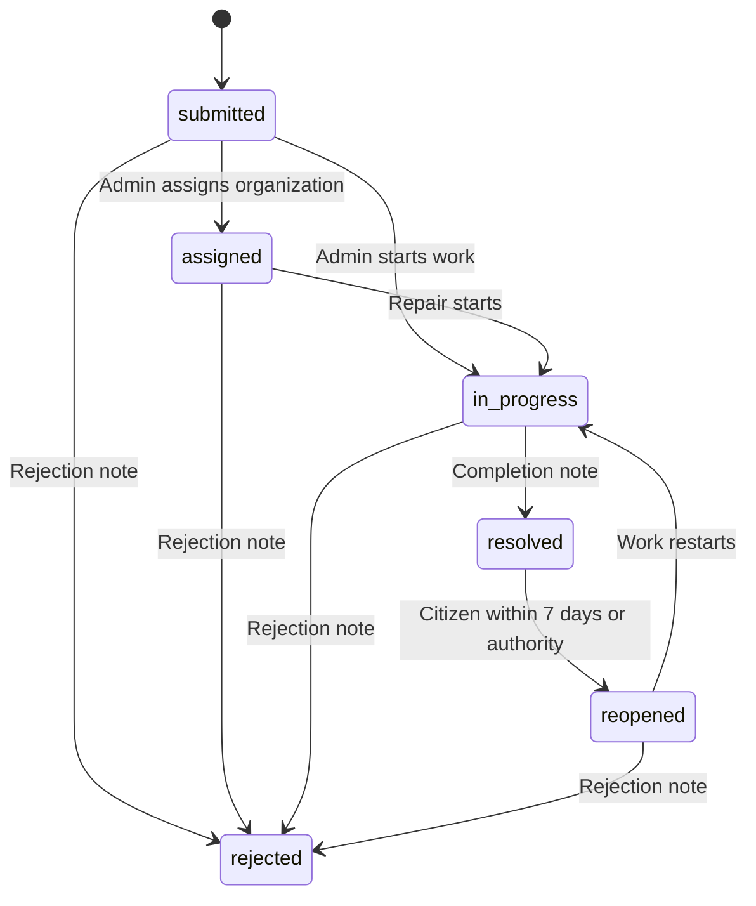

# CivicPulse — technical documentation

## Architecture

The real app is a Next.js App Router application deployed to Vercel. `app/page.tsx` renders the shared React workspace. A Node.js catch-all route at `app/api/[...path]/route.ts` delegates to `src/server.ts`. The server validates input, authenticates the session, authorizes the role/resource and executes parameterized SQL through `src/db.ts` and the Neon HTTP driver.

The static demonstration compiles the same interface using Vite. Its API adapter calls `src/demo.ts`, stores fictional records in local storage and exposes an explicit role selector. This is a product walkthrough, not server authentication. `NEXT_PUBLIC_DEMO_MODE=false` selects the real API; the Vite demo build explicitly selects demo mode. There is no silent production fallback into sample data when Neon fails.

## Source layout

| Path | Responsibility |
| --- | --- |
| `app/layout.tsx`, `app/page.tsx` | Next.js metadata, CSS and root page |
| `app/api/[...path]/route.ts` | Node runtime and HTTP method exports |
| `src/app-client.tsx` | Workspace, dashboard views, navigation, refresh and CSV |
| `src/forms.tsx` | Authentication, report wizard, detail/actions and settings |
| `src/components.tsx` | Shared components, map, illustrations and native dialogs |
| `src/styles.css` | Fonts, responsive layout, focus and reduced-motion styles |
| `src/types.ts`, `src/rules.ts` | Domain types, validation, transitions and metrics |
| `src/api.ts` | Fetch adapter, demo selection and paged report loading |
| `src/server.ts`, `src/db.ts` | Authorized API service and PostgreSQL driver |
| `src/demo.ts` | Explicit browser-local demo data adapter |
| `scripts/schema.sql`, `scripts/migrate.mjs` | Initial schema and non-destructive v1 setup |
| `scripts/create-admin.mjs`, `scripts/cleanup.mjs` | CLI administration and expired-session cleanup |
| `tests/platform.test.ts` | Integration tests using isolated PostgreSQL-compatible PGlite |
| `public/sample-*.svg` | Labeled fictional illustrations for demo records |
| `vercel.json`, `next.config.ts` | Hosting and response-header configuration |

## Database design

`scripts/schema.sql` is the authoritative DDL. IDs use UUIDs; report display codes use a `BIGSERIAL` number. Foreign keys enforce relationship integrity. A check constraint requires an organization role to have an organization ID and excludes that association for citizen/admin roles. Votes use a composite primary key. User email is unique and normalized before writes.

Indexes cover report owner, organization/status, city/category/status, timeline/report, notifications/recipient and session/user. Report list SQL deliberately excludes large photo text. Initial tables use `CREATE TABLE IF NOT EXISTS`; schema version 1 is recorded. Future upgrades must append explicit reviewed migrations rather than assuming that changing the initial file alters existing deployed tables.

The Neon driver uses HTTPS connections rather than a persistent TCP pool. Related registration writes use a transaction. Report creation and status/assignment changes use data-modifying CTEs to create the report/event/notice as one database statement. Status changes include a comparison with the previous state and return HTTP 409 if another update has already changed it.

## Authentication and authorization

Passwords are hashed with bcrypt at cost 12. The API rejects passwords longer than 72 UTF-8 bytes, avoiding bcrypt truncation. Sessions use 48 random bytes encoded as a hex token; only its SHA-256 hash is stored server-side. A cookie is HttpOnly, SameSite=Strict, Path=/ and Secure in production, with a 7-day expiry. Every protected request joins the session with the current active user and current organization approval state. Logout removes the specific session; password changes and account disabling remove all sessions for that user.

Public registration accepts only `citizen` or `organization`. Creating an administrator requires access to the owner’s local environment and the explicit CLI. The CLI never promotes or overwrites an existing email account. Account-management UI cannot disable administrators.

| Resource/action | Citizen | Approved organization | Admin |
| --- | --- | --- | --- |
| Personal/work queue | Own reports | Assigned reports | All reports |
| Public-safe community metadata | Read | Read | Read |
| Authenticated report detail/photo | Read | Read | Read |
| Create report | Yes | No | No |
| Support / remove own support | Yes | No | No |
| Comment | Yes | Assigned only | Any report |
| Repair status update | Reopen own resolved report only | Assigned only | Any report with allowed transition |
| Rate repair | Own resolved report | No | No |
| Assign/reassign | No | No | Approved same-city organization |
| Organization review | No | No | Yes |
| User access changes | No | No | Non-admin accounts only |

Authenticated residents can view infrastructure evidence and comments for community transparency. Reporter ID is redacted for unrelated citizens in detail responses, and reporter email is never included in report responses. The anonymous community route omits reporter identity and image bytes; proofs need a session. Report images are therefore community-visible to signed-in users, not private evidence restricted to the submitter.

## State machine

Admin reassignment of an active report sets it to Assigned and records the new organization. All repair transitions require a 10–1500 character note. Reopening clears the old rating and current resolution time and increments `reopen_count`. A resolved report can be rated only by its reporting citizen. Rejected reports are terminal in phase 1.

Priority response targets are 24h, 48h, 120h and 168h from creation for critical, high, normal and low. Assignment recalculates the target from the report’s creation time using the admin-selected priority. They are project workflow targets, not guaranteed repair times.

## REST API contract

All URLs are relative to `/api`. JSON writes require `Content-Type: application/json`, a same-origin `Origin`, and a session where applicable. Every response is `Cache-Control: no-store`, except authenticated proof responses cached privately for up to an hour. Error shape: `{ "error": "actionable message" }`.

| Method | Path | Body / result |
| --- | --- | --- |
| GET | `/health` | Checks schema access; `{ok:true, mode:"database"}` |
| GET | `/auth/session` | `{user: User|null}` |
| POST | `/auth/register` | name, email, password, city, role, optional organizationName; returns user and session cookie |
| POST | `/auth/login` | email/password; returns user and session cookie |
| POST | `/auth/logout` | Empty JSON; deletes session and clears cookie |
| POST | `/auth/password` | currentPassword, password; invalidates all sessions |
| PATCH | `/profile` | name/city; returns updated user |
| GET | `/community?page=0` | Anonymous-safe 100-record page, newest first; `{issues,hasMore}` |
| GET | `/issues?page=0` | Role-scoped 100-record page; `{issues,hasMore}` |
| POST | `/issues` | title, description, category, address, city, lat, lng, priority, photo data URL |
| GET | `/issues/:id` | Authenticated safe detail, timeline, support and proof URL |
| GET | `/issues/:id/photo` | Authenticated image bytes with validated MIME |
| POST | `/issues/:id/vote` | `{voted: true|false}`; idempotent support intent |
| POST | `/issues/:id/comments` | message, 3–1500 characters |
| PATCH | `/issues/:id/status` | allowed status + 10–1500 character message |
| PATCH | `/issues/:id/assign` | approved same-city organizationId + priority; admin only |
| POST | `/issues/:id/rating` | integer rating 1–5; own resolved report only |
| GET | `/notifications` | Latest 100 own notifications |
| PATCH | `/notifications` | Mark own notices as read |
| GET | `/organizations` | Approved directory; administrators also see applications and contact email |
| PATCH | `/organizations/:id` | approved/rejected; administrator only |
| GET | `/users` | Latest 500 account summaries; administrator only |
| PATCH | `/users/:id` | active boolean; administrator, non-admin target only |

Common response codes: 400 validation, 401 sign-in required, 403 forbidden, 404 missing record/action, 409 duplicate or state conflict, 413 payload too large, 415 non-JSON write, 429 rate limit, 503 database configuration/schema missing, 500 unexpected internal error. Logs retain error name/code rather than full credentials or query details.

## Upload and location handling

The browser accepts JPEG/PNG/WebP inputs up to 10 MB and recompresses them to JPEG at a maximum 1400-pixel edge, reducing quality if necessary. Canvas output omits the original file’s EXIF metadata. The API checks a supported base64 data URL, decoded size from 24 bytes to 800 KB, and expected file signatures. Whole JSON bodies are capped below 1.2 MB. This stays within Vercel’s ordinary function payload limit for the implemented single-photo flow.

Phase 1 stores photo data in Neon to avoid requiring a second provider. Large-scale production should move photos to object storage with direct uploads, content scanning and lifecycle rules. Header signature checks are baseline validation, not a complete image decoding or malware-scanning service.

Location comes from explicit browser GPS permission, map clicking or entered coordinates. Latitude/longitude are validated against world bounds. A map pin must be explicitly confirmed by the UI. The application does not verify physical presence or GPS authenticity, and manual addresses are not automatically reverse-geocoded. The duplicate suggestion uses a haversine distance under 200 metres, matching category and currently active status.

## Security and data care

- All dynamic SQL values are bound parameters. Interpolated SQL fragments are fixed server-controlled role scopes.
- Same-origin JSON writes and SameSite cookies reduce CSRF exposure; there is no permissive CORS handler.
- Authentication rate limits are persisted per normalized email and source-IP key; all rate keys are SHA-256 hashes. Ordinary writes, comments and new reports also have limits.
- React renders submitted text as text; map tooltip text uses DOM `textContent`.
- CSV cells are quoted and values starting with formula characters are prefixed to prevent accidental spreadsheet execution.
- Security headers set content-type protection, frame protection, referrer policy and a CSP adapted to the bundled app/map. CSP permits inline scripts/styles and eval for framework compatibility; tightening to nonces is a future hardening task.
- `.env.local`, `.vercel`, dependencies and generated runtime data are excluded from Git. Only placeholder `.env.example` is included.
- Coordinate/photo/report content is intended for civic transparency. Do not submit unnecessary personal details. This source package does not assert legal/privacy compliance; the operator must adopt an appropriate privacy notice, retention policy and account recovery process before a real public rollout.

## Deployment and configuration

Production needs Node.js 22+ and `DATABASE_URL`; optional `APP_URL` records the canonical origin. Keep `NEXT_PUBLIC_DEMO_MODE=false`. Build does not require a live database: data access happens at runtime. Run migration and admin creation locally against the same Neon branch used by Vercel before testing real sign-in.

`vercel.json` selects Next.js, npm installation/build and the Mumbai function region. Change the region if another location better matches the selected database and hosting-plan availability. Vercel handles HTTPS and the Node runtime. No separate Express service, JWT secret, map API secret or local writable database directory is required.

See `START_HERE_HINDI.md` for the complete deployment procedure. This handoff does not connect the owner’s Neon or Vercel account automatically.

## Scale, reliability and recovery

The API pages reports in groups of 100; the current client aggregates up to 50 pages (5000 reports per scope) for dashboard analytics and local filtering. This is suitable for a project demonstration/pilot, not an unlimited-city dataset. At larger scale, move filtering/analytics into SQL endpoints and adopt cursor pagination, PostGIS proximity queries, object storage and independent map tile hosting. Admin people lists and notification history are capped at 500 and 100 records respectively.

Status compare-and-set protects against simultaneous state changes. Registration and report-related writes are atomic. Session expiry is checked on every protected request; run `npm run db:cleanup` periodically to remove expired rows. Backups and restore procedures depend on the chosen Neon plan and are not configured by this source code. Keep development/test branches separate from real data.

When database configuration is missing, the real UI displays a setup error rather than showing fake success or silently using demo storage. A cold database/network outage may delay or fail an operation; the UI preserves form input where possible and reports errors. Continuous uptime, load capacity, latency, third-party tiles and municipal repair response have not been certified.

## References

- https://nextjs.org/docs/app/guides/environment-variables
- https://nextjs.org/docs/app/api-reference/file-conventions/route
- https://neon.com/docs/guides/nextjs
- https://neon.com/docs/serverless/serverless-driver
- https://vercel.com/docs/frameworks/full-stack/nextjs
- https://vercel.com/docs/environment-variables
- https://vercel.com/docs/functions/limitations
- https://www.openstreetmap.org/copyright
